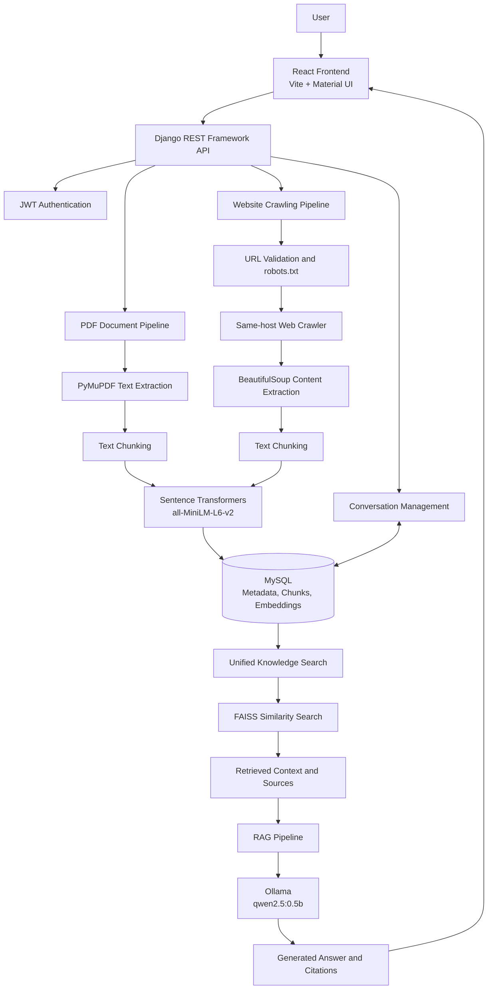

<p align="center">
  <strong>Upload • Crawl • Search • Ask • Learn</strong>
</p>

<p align="center">
  A full-stack AI knowledge assistant that lets users search and ask questions across PDF documents and public websites using Retrieval-Augmented Generation (RAG).
</p>

<p align="center">
  
</p>

---

## Project Demo

<!-- Add your Gemini-generated demo video to docs/demo.mp4, or replace the link below with your YouTube URL. -->
<video width="100%" controls>
  <source src="KnowHUb-Demo-AI-Video.mp4" type="video/mp4">
  Your browser does not support the video tag.
</video>


## Overview

KnowHub AI is an AI-powered knowledge workspace for bringing information from PDF documents and public websites into one searchable place.

Users can upload PDF files, add a website URL for crawling, search across their indexed knowledge, and ask questions in natural language. The application retrieves relevant content using semantic vector search and passes that context to a locally running Large Language Model (LLM) to generate an answer with source references.

The application is built with **React, Django REST Framework, MySQL, Sentence Transformers, FAISS and Ollama**. The current AI workflow runs locally and does not depend on a paid external LLM API.

## Key Features

### Authentication and User Access
- User registration and login.
- JWT authentication using access and refresh tokens.
- Protected API endpoints.
- User-scoped documents, website sources and conversations.

### PDF Document Management
- Upload PDF documents.
- Validate PDF file type and file signature.
- Enforce a maximum upload size of 20 MB.
- Extract PDF text using PyMuPDF.
- Process extracted content into searchable chunks.
- Track document processing status.
- View and delete uploaded documents.

### Website Crawling and Indexing
- Add a public website URL as a knowledge source.
- Configure the maximum number of pages to crawl.
- Validate URLs and restrict crawling to the starting host.
- Check `robots.txt` before crawling pages.
- Extract page titles and readable text using BeautifulSoup.
- Store crawled pages and their chunks.
- View website sources and crawled pages.
- Delete website sources.

**Crawler scope:** The current crawler is designed for public, same-host HTML pages. It does not execute JavaScript or crawl an entire website without limits.

### Text Chunking and Embeddings
- Split extracted PDF and website content into smaller chunks.
- Use overlapping chunks to preserve context.
- Generate 384-dimensional embeddings with `sentence-transformers/all-MiniLM-L6-v2`.
- Store chunk content and embeddings in MySQL.

### Unified Semantic Search
- Search across the user's PDF documents and crawled website pages.
- Convert the search query into an embedding.
- Use FAISS CPU for similarity search.
- Retrieve relevant chunks from the authenticated user's knowledge sources.
- Return source metadata for PDFs and website pages.

### Retrieval-Augmented Generation (RAG)
- Ask questions in natural language.
- Retrieve relevant PDF and website content.
- Build context from the retrieved chunks.
- Send the question and context to the local Ollama model.
- Generate an answer grounded in retrieved content.
- Return source references with the answer.

### AI Chat and Conversation Management
- Create multiple conversations.
- Ask questions within a conversation.
- Store user and assistant messages.
- Reopen previous conversations.
- View conversation history.
- Delete conversations.
- Display source citations for AI answers.

### Modern React Interface
- Dashboard overview.
- Document management page.
- Website sources page.
- Semantic search page.
- AI chat interface.
- Responsive navigation and layout.
- Loading, success and error states.

---

## Technology Stack

| Category | Technology |
|---|---|
| Frontend | React.js |
| Build Tool | Vite |
| UI Library | Material UI (MUI) |
| Routing | React Router DOM |
| HTTP Client | Axios |
| Backend Language | Python |
| Backend Framework | Django |
| API Framework | Django REST Framework |
| Authentication | Django REST Framework Simple JWT |
| Database | MySQL |
| PDF Extraction | PyMuPDF |
| Website Parsing | BeautifulSoup |
| HTTP Requests | Requests |
| Text Embeddings | Sentence Transformers |
| Embedding Model | `all-MiniLM-L6-v2` |
| Vector Search | FAISS CPU |
| Local LLM Runtime | Ollama |
| LLM Model | `qwen2.5:0.5b` |
| Version Control | Git and GitHub |

---

## System Architecture

The application has two knowledge-ingestion paths: PDF documents and public website pages. Both paths produce text chunks and embeddings that can be searched through the unified retrieval pipeline.



### Main Components

| Component | Responsibility |
|---|---|
| React frontend | User interface for documents, websites, search and chat |
| Django REST API | Authentication, application APIs and orchestration |
| PDF pipeline | Extracts and processes uploaded PDF content |
| Website crawler | Validates URLs and extracts same-host public web pages |
| Sentence Transformers | Converts text chunks and questions into vectors |
| MySQL | Stores application data, sources, chunks, embeddings and conversations |
| FAISS | Finds semantically similar vectors |
| RAG service | Combines retrieved context with the user's question |
| Ollama | Runs the local LLM and generates an answer |

---

## How the RAG Pipeline Works

### A. PDF Ingestion

1. The user uploads a PDF from the React application.
2. Django validates the file and stores its metadata and file.
3. PyMuPDF extracts text while retaining page information.
4. The text is split into smaller overlapping chunks.
5. Sentence Transformers generates an embedding for each chunk.
6. Chunk content, page information and embeddings are stored in MySQL.

### B. Website Ingestion

1. The user submits a public website URL and a page limit.
2. The backend validates the URL and checks crawling permission through `robots.txt`.
3. The crawler visits eligible same-host pages within its configured limits.
4. BeautifulSoup extracts page titles and readable text.
5. Page content is split into chunks.
6. Sentence Transformers generates embeddings.
7. Website source records, pages, chunks and embeddings are stored in MySQL.

### C. Question Answering

1. The user enters a question in Search or Chat.
2. The application generates an embedding for the question.
3. The unified search service retrieves the authenticated user's PDF and website chunks.
4. FAISS ranks the vectors by similarity.
5. The RAG service builds context with source metadata.
6. The question and retrieved context are sent to Ollama.
7. Ollama generates an answer using the supplied context.
8. The frontend displays the answer with relevant PDF or website citations.

### Embedding and Search Details

- Embedding model: `sentence-transformers/all-MiniLM-L6-v2`
- Embedding dimensions: 384
- Vector index: FAISS `IndexFlatIP`
- Embeddings are normalized before inner-product similarity search.
- MySQL is the persistent source of truth for stored records and embeddings.
- The current implementation builds the FAISS index from stored embeddings during a search rather than maintaining a persistent FAISS index.

---

## Project Structure

The following is a representative structure. Some filenames may differ depending on the current local implementation.

```text
knowhub-ai/
│
├── backend/
│   ├── config/
│   │   ├── settings.py
│   │   ├── urls.py
│   │   └── __init__.py
│   │
│   ├── accounts/
│   │   ├── models.py
│   │   ├── serializers.py
│   │   ├── views.py
│   │   └── urls.py
│   │
│   ├── documents/
│   │   ├── services/
│   │   │   ├── pdf_extractor.py
│   │   │   ├── text_chunker.py
│   │   │   ├── embedding_service.py
│   │   │   ├── document_processor.py
│   │   │   ├── vector_search.py
│   │   │   ├── llm_service.py
│   │   │   ├── rag_service.py
│   │   │   ├── web_crawler.py
│   │   │   └── web_embedding_service.py
│   │   ├── models.py
│   │   ├── serializers.py
│   │   ├── web_serializers.py
│   │   ├── views.py
│   │   ├── web_views.py
│   │   └── urls.py
│   │
│   ├── conversations/
│   │   ├── models.py
│   │   ├── serializers.py
│   │   ├── views.py
│   │   └── urls.py
│   │
│   ├── manage.py
│   ├── requirements.txt
│   ├── .env.example
│   └── media/                 # Local uploads; do not commit
│
├── frontend/
│   ├── public/
│   ├── src/
│   │   ├── components/
│   │   ├── pages/
│   │   │   ├── Dashboard.jsx
│   │   │   ├── Documents.jsx
│   │   │   ├── Search.jsx
│   │   │   ├── Chat.jsx
│   │   │   └── WebSources.jsx
│   │   ├── services/
│   │   ├── App.jsx
│   │   └── main.jsx
│   ├── package.json
│   └── vite.config.js
│
├── docs/
│   ├── architecture.png
│   └── demo.mp4                 # Optional project demo
│
├── .gitignore
└── README.md
```

---

## Installation and Local Setup

### Prerequisites

Install the following:

- Python compatible with the project's installed dependencies.
- Node.js and npm.
- MySQL Server.
- Ollama.
- Git.

The application is intended to run locally. Docker is not required for this setup.

### 1. Clone the Repository

```bash
git clone https://github.com/MegharajPN/Knowhub-ai.git
cd knowhub-ai
```

Replace `YOUR_USERNAME` with your GitHub username.

### 2. Create the MySQL Database

Run the following in MySQL:

```sql
CREATE DATABASE knowhub_ai
CHARACTER SET utf8mb4
COLLATE utf8mb4_unicode_ci;
```

### 3. Configure the Backend

Open a terminal in the project root:

```powershell
cd backend
python -m venv .venv
.venv\Scripts\Activate.ps1
pip install -r requirements.txt
```

Create a `.env` file inside `backend/`:

```env
SECRET_KEY=replace-with-a-local-django-secret
DEBUG=True

DB_NAME=knowhub_ai
DB_USER=root
DB_PASSWORD=your-local-mysql-password
DB_HOST=127.0.0.1
DB_PORT=3306
```

Use your own local MySQL credentials. Do not commit `.env` to GitHub.

Apply migrations:

```powershell
python manage.py migrate
```

Start Django:

```powershell
python manage.py runserver
```

Backend development server: `http://127.0.0.1:8000/`

### 4. Start Ollama

Install and start Ollama, then pull the model:

```powershell
ollama pull qwen2.5:0.5b
```

Make sure the Ollama service is running and the model is available locally.

The application uses the local Ollama API, normally available at:

`http://localhost:11434/`

### 5. Configure the Frontend

Open a second terminal:

```powershell
cd frontend
npm install
npm run dev
```

Frontend development server: `http://localhost:5173/`

Open the frontend URL in your browser, register an account and start adding knowledge sources.

---

## API Endpoints

The following endpoints are exposed by the Django REST API.

### Authentication

| Method | Endpoint | Description |
|---|---|---|
| POST | `/api/auth/register/` | Register a user |
| POST | `/api/auth/login/` | Login and obtain JWT tokens |
| POST | `/api/auth/token/refresh/` | Refresh an access token |
| GET | `/api/auth/me/` | Get authenticated user information |

### Documents and Knowledge Search

| Method | Endpoint | Description |
|---|---|---|
| GET | `/api/documents/` | List the user's documents |
| POST | `/api/documents/` | Upload a PDF |
| DELETE | `/api/documents/{id}/` | Delete a document |
| POST | `/api/documents/search/` | Search indexed knowledge |
| POST | `/api/documents/ask/` | Ask a question using RAG |

### Website Sources

| Method | Endpoint | Description |
|---|---|---|
| GET | `/api/documents/web-sources/` | List website sources |
| POST | `/api/documents/web-sources/` | Create and crawl a website source |
| GET | `/api/documents/web-sources/{id}/` | Get a source and its crawled pages |
| DELETE | `/api/documents/web-sources/{id}/` | Delete a website source |

### Conversations

| Method | Endpoint | Description |
|---|---|---|
| GET | `/api/conversations/` | List conversations |
| POST | `/api/conversations/` | Create a conversation |
| GET | `/api/conversations/{id}/` | Get a conversation and its messages |
| DELETE | `/api/conversations/{id}/` | Delete a conversation |
| POST | `/api/conversations/{id}/ask/` | Ask a question in a conversation |

Protected endpoints require JWT authentication. Exact request and response fields are defined by the serializers and views in the backend.

---

## Database Design

MySQL stores application records and the source content used by the retrieval pipeline.

### Main Models

**User**

Uses Django's authentication user model.

**Document**

Stores uploaded PDF metadata, including owner, title, file path, file size, processing status and timestamps.

**DocumentChunk**

Stores extracted PDF content, chunk number, page number, embedding and creation timestamp.

**WebSource**

Stores the website source submitted by a user, crawl configuration, status, page count, error information and crawl timestamps.

**WebPage**

Stores crawled page information, including its source, URL, title and extracted content.

**WebPageChunk**

Stores chunked website content and its embedding.

**Conversation**

Stores a user's chat session, title and timestamps.

**Message**

Stores each user or assistant message, its conversation, content, source references and creation timestamp.

---

## Security and Responsible Crawling

The project includes application-level security measures such as:

- JWT authentication for protected APIs.
- User-scoped document, website-source and conversation access.
- PDF extension, file-signature and upload-size validation.
- Environment variables for secrets and database configuration.
- HTTP/HTTPS URL validation for website sources.
- Rejection of localhost and non-public IP destinations by the crawler's URL validation.
- Same-host crawling and redirect validation.
- `robots.txt` checks before crawling.
- Limits on crawl page count, depth, response size and request time.
- Retrieved document and website content treated as untrusted context for the LLM.

**Production security note:** Application-level URL and DNS checks alone are not a complete defense against SSRF or DNS rebinding. A production deployment should also enforce outbound network restrictions and add security testing, monitoring and rate limiting. Respect website terms and crawling policies.

This is a development and portfolio project, not a production-hardened service. Production use would also require HTTPS, secure token storage, malware scanning, production file storage, logging, monitoring, robust authorization tests and operational controls.

---

## Design Decisions

### Why MySQL?

MySQL provides relational storage for users, source metadata, document and website chunks, embeddings and conversation history. It remains the source of truth for the current implementation.

### Why Sentence Transformers?

`all-MiniLM-L6-v2` creates compact 384-dimensional semantic embeddings suitable for local semantic search.

### Why FAISS?

FAISS provides vector similarity search without requiring a separately managed vector database. The current application builds an index from stored embeddings during searches.

### Why Ollama?

Ollama allows the application to run an LLM locally and avoid dependence on a paid external LLM API for the current workflow.

### Why RAG?

RAG retrieves relevant source content before asking the LLM to generate an answer. This helps ground answers in the user's indexed knowledge rather than relying only on the model's general training.

---

## Current Limitations

- PDF is the currently supported uploaded document format.
- Website crawling is limited to public, same-host pages and configured crawl limits.
- JavaScript-rendered website content is not rendered by the crawler.
- Document and website processing are synchronous.
- FAISS indexes are rebuilt from stored embeddings during searches.
- The local `qwen2.5:0.5b` model is small and may produce less detailed answers than larger models.
- Performance depends on available CPU and memory.
- The application is designed for local development and portfolio demonstration, not yet production deployment.

---

## Future Enhancements

Potential improvements include:

- DOCX and TXT document support.
- Background processing with Celery and Redis.
- Persistent FAISS indexes or a dedicated vector database.
- Streaming LLM responses.
- Conversation-aware retrieval and contextual follow-up questions.
- JavaScript-rendered website crawling where appropriate.
- Improved document preview and citation navigation.
- Role-based access control.
- Admin dashboard and usage analytics.
- Automated tests, CI/CD and deployment automation.
- Production observability and security hardening.

---

## What This Project Demonstrates

KnowHub AI demonstrates practical work across:

- Full-stack application development with React and Django REST Framework.
- REST API design and JWT authentication.
- MySQL relational data modelling.
- PDF extraction and website content ingestion.
- Web crawling, URL validation and `robots.txt` handling.
- Text chunking and embedding generation.
- Semantic vector search with FAISS.
- Retrieval-Augmented Generation (RAG).
- Local LLM integration with Ollama.
- Source-aware AI question answering.
- Persistent chat and conversation management.
- Integration of frontend, backend, database and local AI components.

---

## Running the Application Locally

Start the required services in separate terminals:

1. MySQL Server.
2. Ollama with the `qwen2.5:0.5b` model available.
3. Django backend from `backend/`.
4. React frontend from `frontend/`.

Then open `http://localhost:5173/`, register or log in, upload a PDF or add a website source, and use Search or Chat to ask questions.

---

## Git Setup

Before committing, check that local secrets, uploaded files, virtual environments, dependencies and generated model files are excluded.

A starter `.gitignore` for this project can include:

```gitignore
# Environment variables and secrets
.env
.env.*
!.env.example

# Python
__pycache__/
*.py[cod]
*.pyo
.venv/
venv/
.pytest_cache/

# Django local data
backend/db.sqlite3
backend/media/
backend/staticfiles/

# Frontend dependencies and builds
node_modules/
dist/
.vite/

# Local model and generated files
*.faiss
*.index
.cache/
.cache_huggingface/

# Editors and operating systems
.vscode/
.idea/
.DS_Store
Thumbs.db
```

Review this list against your actual project before committing. Keep `requirements.txt`, frontend lock files and documentation in Git. Do not commit database passwords, secret keys, private uploads or large downloaded model weights.

Initialize and commit the project:

```bash
git init
git status
git add .
git status
git commit -m "Initial commit: KnowHub AI knowledge assistant"
```

Add your GitHub repository as the remote and push:

```bash
git branch -M main
git remote add origin https://github.com/MegharajPN/Knowhub-ai.git
git push -u origin main
```

Replace the repository URL with your actual GitHub repository. Review `git status` and the staged files before committing.

---

## Author

**KnowHub AI — Full-Stack AI Portfolio Project**

**Technology:** Python | Django REST Framework | React.js | MySQL | Sentence Transformers | FAISS | Ollama | RAG

GitHub: `https://github.com/MegharajPN`

---

## License

This repository is intended as an educational and portfolio project. No open-source license is granted unless a separate license file is added to the repository.