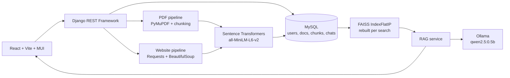

# 00 — Project Overview

## 1. What problem does KnowHub AI solve?

Organizations keep important knowledge in PDFs and public web pages. That knowledge is hard to use because:

- users must open each file and search manually;
- keyword search does not understand meaning;
- a normal chatbot does not know the organization's private documents;
- answers usually have no traceable source;
- information is spread across documents and websites.

KnowHub AI brings those sources into one workspace. Users upload PDFs or add a website, the backend converts the content into searchable chunks and embeddings, and the user can ask questions in natural language. The answer is generated from retrieved content and returned with source references.

> **Verified in code:** PDF upload, website crawl, chunking, embeddings, unified vector search, RAG answer generation, citations, and conversation persistence all have implementation files.

---

## 2. Why was this application built?

From `README.md`, KnowHub AI is an **educational and portfolio project** demonstrating a full-stack AI knowledge assistant. It also deliberately uses a local Ollama model so the workflow does not depend on a paid external LLM API.

What can be stated confidently:

- It demonstrates React + Django REST Framework + MySQL + RAG integration.
- It demonstrates local AI with Sentence Transformers, FAISS, and Ollama.
- It is intended to run locally.

What should **not** be claimed:

- That it was deployed for a real enterprise customer.
- That it is production-hardened.
- That it processes large-scale production traffic.

A good interview phrase:

> “I built it as a portfolio project to prove I could implement the complete RAG loop myself — not just call a chat API. I wanted to show ingestion, retrieval, grounded generation, citations, authentication, and a usable frontend working end to end.”

---

## 3. Who are the intended users?

Based on the implemented features, the intended users are:

| User | Need | Implemented support |
|---|---|---|
| Knowledge worker | Find information inside PDFs | Upload, list, delete, semantic search |
| Researcher/analyst | Ask questions across documents and websites | Unified search and RAG chat |
| Team member | Keep a history of questions | Conversations and messages |
| Application owner | Keep user data separated | JWT auth and user-scoped querysets |
| Developer/portfolio reviewer | Inspect a complete AI app | README, architecture image, demo link |

Enterprise roles such as admins, reviewers, compliance officers, or tenant managers are **NOT IMPLEMENTED**. There is no role-based access control.

---

## 4. What business problems can it solve?

The current design can address these problems conceptually:

1. **Faster knowledge discovery** — semantic search finds meaning, not only exact words.
2. **Grounded question answering** — the LLM is instructed to answer from retrieved context.
3. **Traceability** — each answer returns source metadata such as document title, page, URL, and similarity.
4. **Knowledge consolidation** — PDFs and crawled websites use one retrieval pipeline.
5. **Lower API cost for a demo** — Ollama runs locally instead of calling a paid hosted LLM.
6. **User-private workspace** — documents, website sources, and conversations are filtered by owner.

Important honesty note: these are **capabilities demonstrated by the local implementation**, not measured business outcomes from a customer deployment.

---

## 5. What makes it different from a normal chatbot?

| Normal chatbot | KnowHub AI |
|---|---|
| Answers mainly from model training | Retrieves content from the user's PDFs/websites first |
| No access to private files | Ingests user-uploaded PDFs and public web pages |
| Usually no source trail | Returns `sources` with answer |
| Static knowledge | New documents/websites become searchable after indexing |
| Can confidently guess | Prompt tells the model to use only provided context and to say when information is missing |
| Usually no conversation persistence in a demo | Conversations and messages are stored in MySQL |

The important distinction: **the model is not the knowledge base**. MySQL + embeddings are the knowledge base; Ollama/Qwen is the language generator.

---

## 6. Overall architecture — short version

Detailed diagrams are in `01_SYSTEM_ARCHITECTURE.md`.

---

## 7. Technologies and responsibilities

| Technology | Where it appears | Responsibility |
|---|---|---|
| React 19 | `frontend/package.json`, `frontend/src/` | User interface and client state |
| Vite | `frontend/vite.config.js` | Frontend dev server and build tool |
| Material UI | `frontend/src/theme.js`, pages | Components and visual design |
| React Router DOM | `frontend/src/App.jsx`, `main.jsx` | Client-side routes and protected layout |
| Axios | `frontend/src/services/api.js` | HTTP calls, JWT header, refresh interceptor |
| Python | `backend/` | Backend language |
| Django | `backend/config/` | Web framework, ORM, auth, migrations |
| Django REST Framework | Views/serializers | API endpoints, parsing, permissions, responses |
| Simple JWT | `backend/accounts/urls.py`, settings | Access/refresh token endpoints and auth class |
| MySQL | `backend/config/settings.py` | Persistent application data and embeddings |
| PyMuPDF | `pdf_extractor.py` | PDF text extraction per page |
| Requests | `llm_service.py`, `web_crawler.py` | HTTP calls to Ollama and crawled websites |
| BeautifulSoup | `web_crawler.py` | HTML parsing and readable text extraction |
| Sentence Transformers | `embedding_service.py` | Generate 384-dimensional embeddings |
| FAISS CPU | `vector_search.py` | Exact inner-product similarity search |
| Ollama | `llm_service.py` | Local LLM runtime |
| Qwen 2.5 0.5B | `llm_service.py` | Local model used for answer generation |
| Git/GitHub | Repository | Version control |

Dependency note: no `requirements.txt` was found, so exact Python package versions are **NEEDS VERIFICATION**. The frontend versions are visible in `frontend/package.json`.

---

## 8. Interview introductions

### 8.1 30-second explanation

> KnowHub AI is a full-stack RAG knowledge assistant I built with React, Django REST Framework, and MySQL. Users can upload PDFs or add a public website; the backend extracts text, splits it into overlapping chunks, creates embeddings with `all-MiniLM-L6-v2`, and stores them in MySQL. On a question, the app builds a FAISS index from the user's stored embeddings, retrieves the most relevant PDF and website chunks, and sends that context with the question to a local Qwen model through Ollama. The response includes source references, and chat history is stored in MySQL. It is currently a local portfolio application, not a production deployment.

### 8.2 1-minute explanation

> The problem I targeted is that useful knowledge is often trapped in PDFs and websites, and a normal chatbot cannot answer from those private or specific sources with traceability. KnowHub AI solves this with two ingestion pipelines. For PDFs, Django validates the upload, PyMuPDF extracts page-by-page text, and a chunker creates 1,000-character chunks with 200-character overlap. For websites, a same-host crawler checks URL safety and robots.txt, fetches HTML, and extracts readable text with BeautifulSoup. Both pipelines use the same Sentence Transformers model to generate normalized 384-dimensional embeddings and store chunk text plus embeddings in MySQL.
>
> At query time, the service loads only the authenticated user's PDF and website chunks, builds an in-memory FAISS `IndexFlatIP`, embeds the question with the same model, and retrieves the top matches. The RAG service formats those chunks as source context and asks Ollama's `qwen2.5:0.5b` model to answer using only that context. The frontend displays the answer with citations and saves the exchange in a conversation. JWT protects the APIs and querysets are user-scoped. The main limitation I would call out is that processing and crawling are synchronous and the FAISS index is rebuilt per search, which I would move to background jobs and a persistent index in production.

### 8.3 2-minute explanation

> KnowHub AI is an end-to-end enterprise knowledge assistant prototype that I built to demonstrate full-stack AI engineering, not just model calling. The frontend is React with Vite and Material UI. It talks to a Django REST Framework API using Axios, with Simple JWT access and refresh tokens stored in the browser. The backend has three Django apps — `accounts`, `documents`, and `conversations` — and MySQL is configured as the database.
>
> There are two ingestion flows. In the PDF flow, the serializer checks that the file is a `.pdf`, is under 20 MB, and starts with the PDF signature. `process_document()` then marks the document processing, extracts text page by page with PyMuPDF, chunks each page with overlap, generates embeddings, and stores `DocumentChunk` rows in one database transaction. In the website flow, a URL is validated for HTTP/HTTPS, localhost and private IPs are rejected, redirects are checked, `robots.txt` is fetched, and a bounded same-host crawler extracts text and links from HTML. Website pages become `WebPage` and `WebPageChunk` rows with embeddings.
>
> Retrieval is unified. `search_knowledge()` fetches both PDF and website chunks belonging to the current user, keeps metadata such as `source_type`, `document_id`, `page_number`, `page_url`, and `web_source_id`, and `_search_faiss()` builds a fresh `IndexFlatIP(384)` from the stored vectors. Because `embedding_service.py` normalizes embeddings, inner-product search behaves like cosine-similarity ranking. The RAG service turns the top results into numbered source blocks, and `llm_service.py` posts the prompt to Ollama's `/api/generate` endpoint using `qwen2.5:0.5b`, low temperature, and a response limit. The answer and structured sources go back to the frontend, and chat messages are persisted.
>
> I would present the main engineering trade-offs honestly: I chose local Ollama to avoid API cost, MySQL as the source of truth, and in-memory FAISS for simplicity. Before production I would add Celery/Redis for asynchronous ingestion, persistent vector indexing or a vector database, HTTPS and production Django settings, outbound network controls for the crawler, automated tests, monitoring, rate limiting, and better evaluation of retrieval quality.

---

## 9. One-line answers to common opening questions

| Interviewer asks | Short answer |
|---|---|
| “What did you build?” | “A local full-stack RAG assistant over PDFs and websites with citations and chat history.” |
| “Is it deployed?” | “No. It runs locally as a portfolio project; production deployment is a proposed next step.” |
| “Which model?” | “`all-MiniLM-L6-v2` for embeddings and local `qwen2.5:0.5b` through Ollama for generation.” |
| “Which vector DB?” | “No separate vector DB; FAISS is built in memory from embeddings stored as JSON in MySQL.” |
| “How do you prevent cross-user access?” | “JWT identifies the user, and querysets filter documents, web sources, and conversations by that user.” |
| “What is the biggest limitation?” | “Synchronous processing and rebuilding the FAISS index on every search.” |
| “Why RAG?” | “It grounds answers in user-owned source content and gives source references.” |
