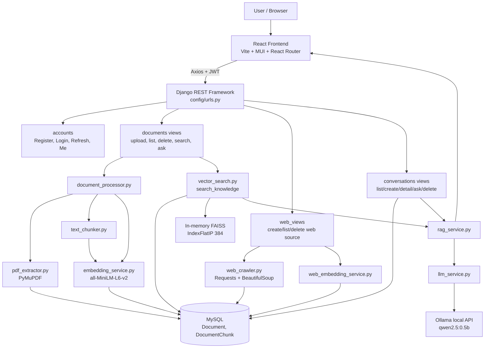
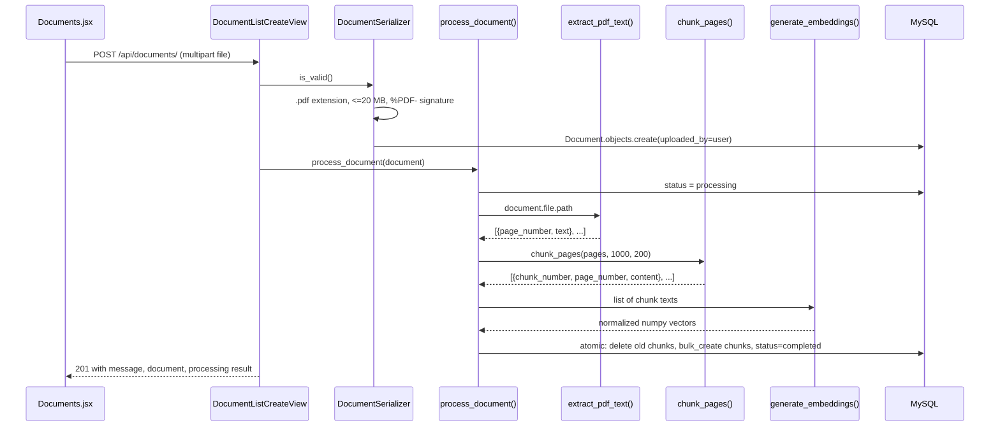
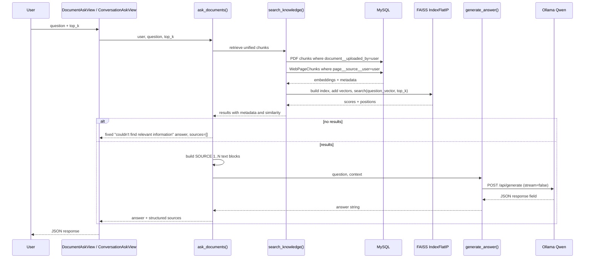
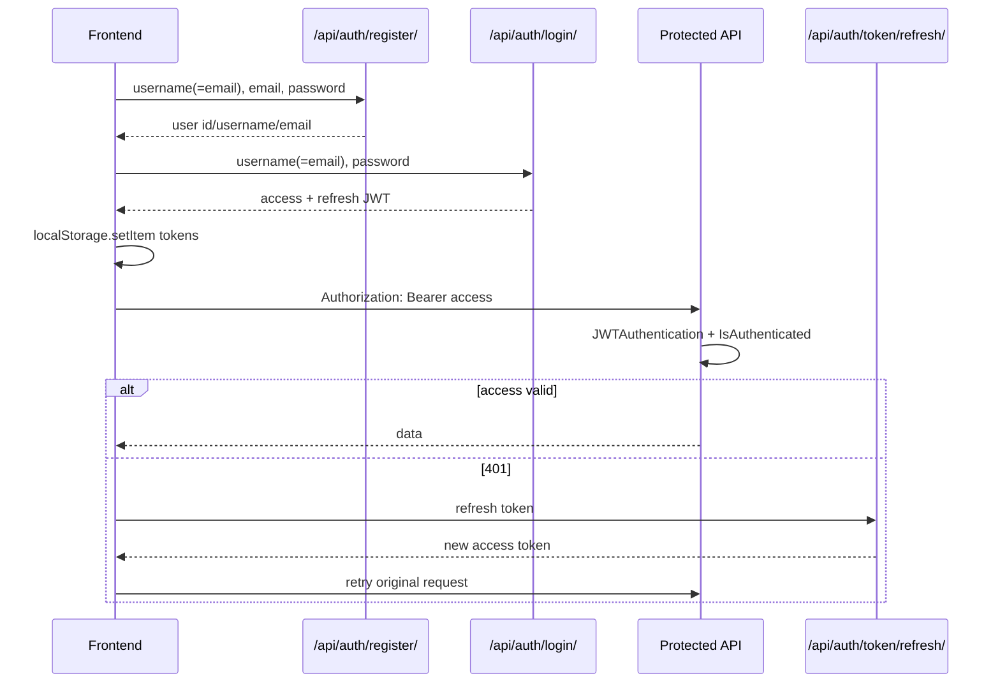
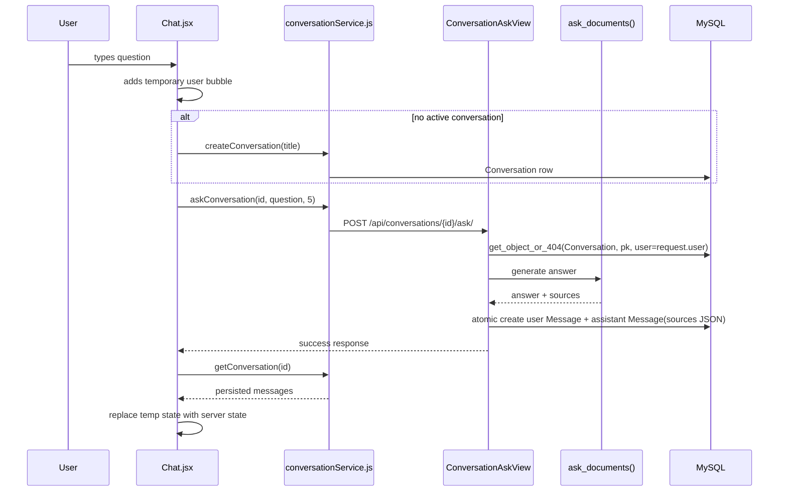
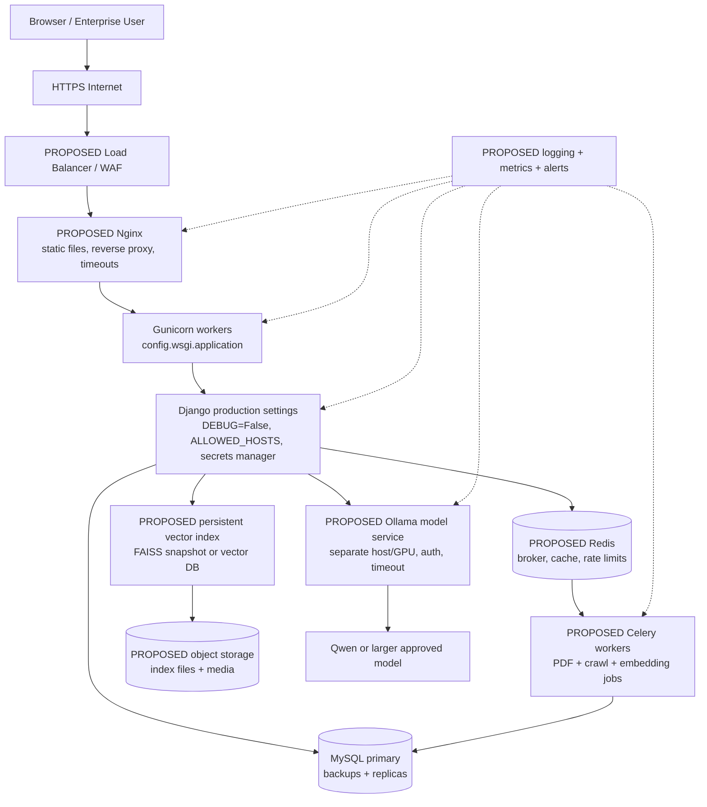

# 01 — Complete System Architecture

All diagrams below are based on the inspected code. The final diagram is explicitly **PROPOSED** and is not present in the repository.

---

## 1. Component responsibilities

| Layer | Component | Actual responsibility |
|---|---|---|
| Client | `frontend/src/` | Forms, upload, crawl trigger, search, chat, citation rendering |
| Client | `services/api.js` | Axios base URL, JWT header, multipart handling, refresh retry |
| API | `backend/config/urls.py` | Routes `/admin/`, `/api/auth/`, `/api/documents/`, `/api/conversations/` |
| API | DRF views | Parse requests, enforce `IsAuthenticated`, call services, return `Response` |
| Validation | Serializers | Validate PDF, query, ask, and web-source payloads |
| Domain | `documents/services/` | Extraction, chunking, embeddings, crawl, FAISS, RAG, Ollama |
| Persistence | MySQL | Users, documents, chunks, web sources, pages, conversations, messages, embeddings |
| AI | Sentence Transformers | Convert text to vectors; model loaded lazily into a global singleton |
| AI | FAISS | Search vectors with `IndexFlatIP` |
| AI | Ollama + Qwen | Generate the natural-language answer |

---

## 2. Diagram 1 — Overall application architecture (IMPLEMENTED)



---

## 3. Diagram 2 — PDF ingestion pipeline (IMPLEMENTED)



Failure path: if any step after record creation raises, `process_document()` sets `status = failed` and re-raises. `DocumentListCreateView.create()` catches the exception and still returns **HTTP 201** with a generic failure message.

---

## 4. Diagram 3 — Website crawling pipeline (IMPLEMENTED)

```mermaid
flowchart TB
    A[WebSources.jsx form] --> B[POST /api/documents/web-sources/]
    B --> C[WebSourceCreateSerializer<br/>url + max_pages 1..20]
    C --> D[Create WebSource<br/>status=processing]
    D --> E[crawl_website(start_url, max_pages)]
    E --> F[validate_public_url<br/>scheme, host, private IP, port, credentials]
    F --> G[safe_fetch robots.txt<br/>manual redirects, 2 MB cap]
    G --> H{robots allows?}
    H -- no --> X[Stop / error]
    H -- yes --> I[BFS queue, visited set<br/>same host, depth <=2]
    I --> J[safe_fetch page]
    J --> K[BeautifulSoup<br/>remove script/style/nav/footer<br/>extract title, text, links]
    K --> L[WebPage update_or_create]
    L --> M[process_web_source]
    M --> N[chunk_text 1000/200]
    N --> O[generate_embeddings]
    O --> P[(MySQL WebPageChunk)]
    P --> Q[status=completed<br/>last_crawled_at]
    Q --> R[Response with pages + embedding_result]
```

Verified limitation: `WebSourceCreateSerializer` expects the field name `url`, but `frontend/src/services/webSourceService.js` sends `root_url`. This is a frontend/backend mismatch.

---

## 5. Diagram 4 — Embedding generation pipeline (IMPLEMENTED)

```mermaid
flowchart LR
    T1[PDF chunk text] --> G[generate_embeddings(texts)]
    T2[Website chunk text] --> G
    G --> M1[get_embedding_model()<br/>lazy global _model]
    M1 --> ST[SentenceTransformer<br/>sentence-transformers/all-MiniLM-L6-v2]
    ST --> ENC[model.encode<br/>convert_to_numpy=True<br/>normalize_embeddings=True<br/>show_progress_bar=False]
    ENC --> V[NumPy array shape N x 384]
    V --> S1[embedding.tolist() -> MySQL JSON]
    V --> S2[used directly for FAISS float32 vectors]
    Q[User question] --> GQ[generate_embeddings([question])]
    GQ --> QV[1 x 384 normalized vector]
```

Key point: Sentence Transformers creates embeddings. FAISS only searches them.

---

## 6. Diagram 5 — RAG retrieval and generation pipeline (IMPLEMENTED)



No streaming is implemented. The frontend waits for the full response.

---

## 7. Diagram 6 — Authentication workflow (IMPLEMENTED)



Server-side nuance: `RegisterView` uses `AllowAny`; `CurrentUserView` and all document/web/conversation views require authentication. The layout also performs a client-side check with `GET /api/auth/me/`, but backend permissions are the real protection.

---

## 8. Diagram 7 — Chat conversation workflow (IMPLEMENTED)



Important: prior messages are **not** passed to the retriever or the LLM. Conversation-aware retrieval is **NOT IMPLEMENTED**.

---

## 9. Diagram 8 — Proposed production deployment architecture (PROPOSED — NOT IMPLEMENTED)



Everything labelled **PROPOSED** is absent from the repository. See `12_PRODUCTION_DEPLOYMENT.md`.

---

## 10. Request flow from URL to response

Example: `POST /api/documents/ask/`

1. Browser sends JSON with Axios. `api.js` adds `Authorization: Bearer <access>`.
2. `config/urls.py` maps `/api/documents/` to `documents.urls`.
3. `documents/urls.py` maps `ask/` to `DocumentAskView.as_view()`.
4. DRF's `JWTAuthentication` validates the token because `DEFAULT_AUTHENTICATION_CLASSES` is configured globally.
5. `IsAuthenticated` rejects anonymous users.
6. `DocumentAskSerializer` validates `question` (nonblank, max 1000) and `top_k` (1–10, default 5).
7. View calls `ask_documents(user=request.user, question=..., top_k=...)`.
8. Service layer retrieves, builds context, calls Ollama, and returns a dictionary.
9. View converts the dictionary into a DRF `Response`.
10. Any service exception is caught and returned as HTTP 500 with a generic message.

---

## 11. How data isolation works in the architecture

| Resource | Filter used | Source |
|---|---|---|
| Documents | `Document.objects.filter(uploaded_by=self.request.user)` | `documents/views.py` |
| Document detail/delete | same queryset inside `RetrieveDestroyAPIView` | `documents/views.py` |
| PDF chunks for search | `document__uploaded_by=user` | `vector_search.py` |
| Web sources | `WebSource.objects.filter(user=request.user)` | `web_views.py` |
| Web source detail/delete | `get_object_or_404(WebSource, pk=pk, user=request.user)` | `web_views.py` |
| Web chunks for search | `page__source__user=user` | `vector_search.py` |
| Conversations | `Conversation.objects.filter(user=request.user)` | `conversations/views.py` |
| Conversation ask | `get_object_or_404(Conversation, pk=pk, user=request.user)` | `conversations/views.py` |

This is solid application-level isolation. Automated authorization regression tests are **NOT IMPLEMENTED**.

---

## 12. Architectural trade-offs to discuss in interviews

| Decision | Benefit today | Production trade-off |
|---|---|---|
| MySQL JSON embeddings | One source of truth, simple transactions | Large JSON arrays are inefficient for millions of vectors |
| FAISS built per search | Always reflects latest DB rows, no index sync | O(N) load cost per query; no persistence |
| `IndexFlatIP` | Exact results, simple | Slow at very large scale; no compression |
| Normalized embeddings + inner product | Equivalent ranking to cosine | Requires same preprocessing at index and query time |
| Local Ollama | No paid API, private local demo | Needs GPU/host capacity, timeouts, model lifecycle |
| Synchronous processing | Simple request/response | Long HTTP requests, worker exhaustion |
| BFS crawler with limits | Bounded and readable | No JS rendering, no distributed queue |
| JWT in `localStorage` | Easy SPA demo | XSS exposure; prefer secure HTTP-only cookies in production |
| Service modules | Thin views, testable business logic | Needs formal tests and dependency injection for real unit testing |
