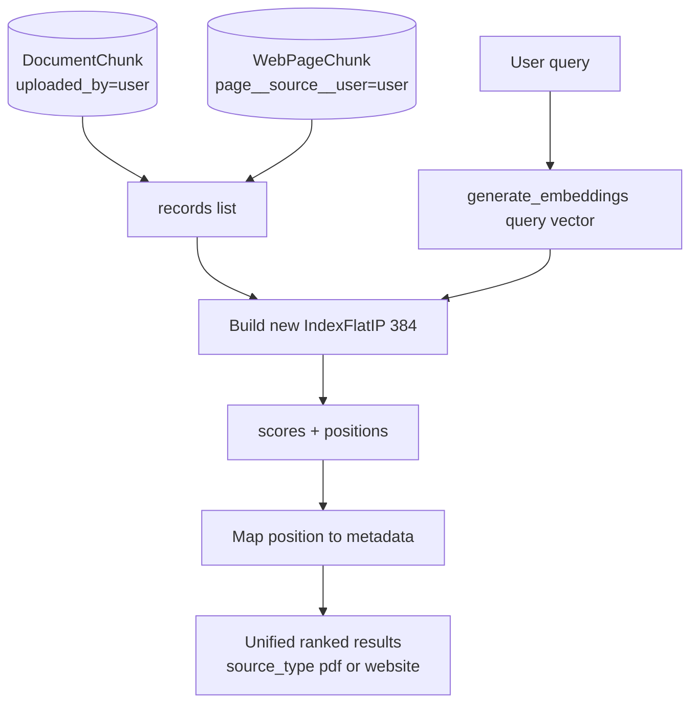

# 04 — FAISS: Complete Explanation

Primary source: `backend/documents/services/vector_search.py`.

---

## 1. What is FAISS?

FAISS is a library for efficient similarity search over vectors. It is used to answer: “Which stored vectors are closest to this query vector?”

It does not understand language. It receives numbers and compares them.

---

## 2. What does FAISS stand for?

**Facebook AI Similarity Search**. The library was originally developed at Facebook AI Research and is now widely used as a standalone vector-search library.

---

## 3. Why use FAISS here?

- Fast exact similarity search on CPU.
- Simple Python API.
- No separate vector database service is needed for a local demo.
- Works directly with NumPy arrays.

In KnowHub AI it is used in `search_knowledge()` and `search_documents()`.

---

## 4. What FAISS is not

| Question | Answer | Evidence in project |
|---|---|---|
| Is FAISS an embedding model? | **No** | Embeddings come from `embedding_service.py` |
| Is FAISS an LLM? | **No** | Answers come from Ollama/Qwen |
| Is FAISS a database? | **No** | Records live in MySQL; FAISS index exists only during search |
| Does FAISS understand text? | **No** | It receives `float32` vectors |

A strong interview line:

> “In this project, MySQL stores the vectors, Sentence Transformers creates them, FAISS searches them, and Ollama writes the answer.”

---

## 5. What is a vector index?

A vector index is a data structure optimized for nearest-neighbor search. Instead of comparing a query to every vector in a naive application loop, an index organizes vectors for faster lookup.

FAISS provides many index types, from exact flat indexes to approximate indexes using clustering, quantization, or graph traversal.

---

## 6. What is `IndexFlatIP`?

`faiss.IndexFlatIP(384)` is an exact flat index using **inner product** as the similarity measure.

- `Flat` = no compression or approximation; all vectors are stored and scanned.
- `IP` = inner product score.
- `384` = vector dimension.

It is simple and exact, but it does not scale cheaply to very large collections.

---

## 7. What does the 384 parameter mean?

Every vector added to the index must have exactly 384 values. The code also enforces this with `DIMENSIONS = 384`.

If a stored embedding has 768 values, `vectors.shape[1] != DIMENSIONS` and the search raises `ValueError`.

The number comes from the `all-MiniLM-L6-v2` model configured in `embedding_service.py`.

---

## 8. Inner product and cosine similarity

Inner product:

```text
score(A, B) = sum(A[i] * B[i])
```

Cosine similarity:

```text
cos(A, B) = (A · B) / (||A|| * ||B||)
```

Because `embedding_service.py` calls `normalize_embeddings=True`, all vectors have length 1. Therefore:

```text
||A|| = 1 and ||B|| = 1
cos(A, B) = A · B
```

So `IndexFlatIP` over normalized vectors gives cosine-similarity ranking.

If embeddings were not normalized, inner product would mix semantic direction with vector magnitude.

---

## 9. Exact search vs approximate nearest neighbor

| Exact search | Approximate nearest neighbor (ANN) |
|---|---|
| Checks all vectors | Uses index structure to avoid many comparisons |
| Guaranteed nearest result | High probability, not guaranteed |
| Simple | More parameters and tuning |
| Memory-heavy at scale | Compresses or partitions vectors |
| `IndexFlatIP` here | NOT IMPLEMENTED in this project |

FAISS supports ANN options such as IVF, PQ, and HNSW-style indexes, but this project uses only `IndexFlatIP`.

---

## 10. Exact FAISS workflow in this project

```python
DIMENSIONS = 384

def _search_faiss(query, records, top_k):
    if not records:
        return []

    vectors = np.asarray(
        [record["embedding"] for record in records],
        dtype=np.float32,
    )

    if vectors.ndim != 2 or vectors.shape[1] != DIMENSIONS:
        raise ValueError("Stored embeddings must have 384 dimensions.")

    if not np.isfinite(vectors).all():
        raise ValueError("Stored embeddings contain invalid values.")

    index = faiss.IndexFlatIP(DIMENSIONS)
    index.add(vectors)

    query_vector = generate_embeddings([query]).astype(np.float32)

    result_count = min(top_k, len(records))
    scores, positions = index.search(query_vector, result_count)

    results = []

    for score, position in zip(scores[0], positions[0]):
        if position < 0:
            continue

        result = records[int(position)]["metadata"].copy()
        result["similarity"] = round(float(score), 4)

        results.append(result)

    return results
```

Step by step:

1. Return `[]` if no records.
2. Convert stored embedding lists into a `float32` NumPy matrix.
3. Validate shape `(N, 384)`.
4. Validate all values are finite.
5. Create a new exact inner-product index.
6. Add all vectors.
7. Embed the query with the same Sentence Transformers model.
8. Search for `min(top_k, N)` results.
9. FAISS returns score matrix and position matrix.
10. Map each position back to `records[position]["metadata"]`.
11. Add rounded `similarity` to the result.

---

## 11. Is the FAISS index stored permanently?

**No.**

Verified from `vector_search.py`:

- there is no `faiss.write_index(...)`;
- there is no index file path;
- there is no `faiss.read_index(...)`;
- the index is created with `faiss.IndexFlatIP(DIMENSIONS)` inside `_search_faiss()`;
- it is local to one search call and discarded when the function ends.

Correct interview statement:

> “MySQL is the persistent source of truth. The FAISS index is rebuilt from stored embeddings on every search.”

README also states this, and the code confirms it.

---

## 12. How does MySQL store embeddings and how does FAISS use them?

### MySQL

Models in `documents/models.py`:

```python
embedding = models.JSONField(null=True, blank=True)
```

Both `DocumentChunk` and `WebPageChunk` use JSON fields. During ingestion:

```python
embedding=embedding.tolist()
```

So a NumPy vector is converted to a Python list and serialized as JSON.

### FAISS

During search:

```python
vectors = np.asarray(
    [record["embedding"] for record in records],
    dtype=np.float32,
)
```

The JSON lists are converted back into a numeric matrix and added to the index.

### Why this design?

- simple for a local demo;
- database writes are transactional;
- search always sees the latest committed embeddings;
- no index synchronization code is needed.

### Why not production?

- loading all vectors for every query is expensive;
- JSON arrays have overhead;
- memory grows with chunk count;
- each web worker reloads data;
- no ANN index.

---

## 13. How does FAISS return matching vectors?

`index.search(query_vector, result_count)` returns two arrays:

```python
scores, positions = index.search(query_vector, result_count)
```

For one query vector:

- `scores[0]` contains similarity scores;
- `positions[0]` contains integer positions in the added vector array.

The application does not return raw vectors. It uses positions to retrieve metadata.

---

## 14. How do we map a retrieved vector back to its MySQL chunk?

This project uses a parallel list called `records`.

Each record has:

```python
{
    "embedding": chunk.embedding,
    "metadata": {...}
}
```

FAISS position `i` corresponds to `records[i]`. Therefore:

```python
result = records[int(position)]["metadata"].copy()
```

No separate vector-ID map is needed because the index is rebuilt in the same order as `records`.

---

## 15. Metadata available after retrieval

### PDF result

```python
{
    "source_type": "pdf",
    "chunk_id": chunk.id,
    "document_id": chunk.document_id,
    "document_title": chunk.document.title,
    "page_number": chunk.page_number,
    "page_url": None,
    "content": chunk.content,
    "similarity": 0.7123
}
```

### Website result

```python
{
    "source_type": "website",
    "chunk_id": chunk.id,
    "document_id": None,
    "document_title": page.title or source.title or page.url,
    "page_number": None,
    "page_url": chunk.page.url,
    "web_source_id": chunk.page.source_id,
    "content": chunk.content,
    "similarity": 0.6841
}
```

The frontend detects website citations with:

```javascript
const isWebsite =
  source.source_type === "website" || Boolean(source.page_url);
```

---

## 16. Top-K search

Top-K means returning only the K highest-scoring results.

Code:

```python
result_count = min(top_k, len(records))
scores, positions = index.search(query_vector, result_count)
```

Validation:

- `DocumentAskSerializer.top_k`: 1–10, default 5;
- `DocumentSearchSerializer.top_k`: 1–10, default 5;
- conversation ask manually validates 1–10.

If a user has fewer chunks than K, the smaller count is used.

---

## 17. How would FAISS perform at 1 million or 10 million vectors?

Do not give fabricated numbers. Explain the shape of the problem.

With `IndexFlatIP`:

- every query scores every vector;
- 1 million × 384 floats is roughly 384 million float values, about 1.5 GB just for raw float32 vectors, before index metadata, Python/NumPy copies, and query overhead;
- 10 million × 384 floats is roughly 3.84 billion floats, about 15 GB raw, realistically more;
- the current code also reads all JSON rows from MySQL and builds the array per query, so the total cost is much worse than raw FAISS memory.

Correct interview answer:

> “`IndexFlatIP` is exact but linear in the number of vectors. At millions of chunks, I would not rebuild it per request. I would persist the index, load it once per worker, support incremental updates, and likely move to an ANN index such as IVF-PQ/HNSW or a managed vector database. I would also benchmark on real hardware before making performance claims.”

---

## 18. Limitations of `IndexFlatIP`

1. Exact search means full scan.
2. No compression.
3. No metadata storage inside FAISS; metadata lives in the parallel `records` list.
4. Rebuilt on every search in this project.
5. No incremental add/delete persistence.
6. Inner product assumes normalized vectors.
7. Requires all embeddings to be exactly 384 dimensions.
8. Single-process in-memory index; no sharing between workers.
9. No built-in user filtering; filtering happens in MySQL before indexing.
10. Not a transactional system of record.

---

## 19. Unified PDF + website search flow



The same FAISS index contains both source types for a single search, so ranking is unified.

---

## 20. PDF-only compatibility function

`search_documents(user, query, top_k=5)` still exists. It:

- filters only `DocumentChunk`;
- builds metadata without `source_type`;
- calls the same `_search_faiss()`.

It is described in code as “Backward-compatible PDF-only search.” It is not the path used by the current `/search/` endpoint; that endpoint uses `search_knowledge()`.

---

## 21. Simple example based on the actual implementation

```python
from documents.services.vector_search import search_knowledge

results = search_knowledge(
    user=request.user,
    query="What is the leave policy?",
    top_k=3,
)

for result in results:
    print(result["source_type"], result["document_title"], result["similarity"])
```

Possible output shape:

```text
pdf Employee Handbook 0.7321
website HR Portal 0.6814
pdf Policies 2026 0.6109
```

This is illustrative output shape, not a recorded benchmark.

---

## 22. Interview Q&A

### Q1. Is FAISS a database?

**Spoken:** “No. It is a similarity-search library. Our database is MySQL.”

**Detail:** The index is rebuilt in memory and thrown away after each search.

**Source:** `vector_search.py`, `models.py`.

**Follow-up:** What is the source of truth? MySQL.

---

### Q2. How do you map a FAISS result back to a document?

**Spoken:** “We keep a parallel records list. FAISS gives a position, and we use that position to read metadata from the list.”

**Detail:** `records[int(position)]["metadata"]`.

**Source:** `vector_search.py`.

**Follow-up:** What if the index persisted? Then we would need stable vector IDs stored with the index.

---

### Q3. Why is inner product used?

**Spoken:** “Because embeddings are normalized, inner product equals cosine similarity.”

**Detail:** `normalize_embeddings=True` and `IndexFlatIP`.

**Source:** `embedding_service.py`, `vector_search.py`.

**Follow-up:** How would you verify? `np.linalg.norm(vector)` should be about 1.

---

### Q4. Is the index rebuilt every search?

**Spoken:** “Yes, in the current implementation.”

**Detail:** `IndexFlatIP` is constructed inside `_search_faiss()`.

**Source:** `vector_search.py`.

**Follow-up:** Why is that acceptable here? Local demo with modest data; production needs persistence.

---

### Q5. What happens on dimension mismatch?

**Spoken:** “We raise a ValueError before calling FAISS.”

**Detail:** Shape check against `DIMENSIONS = 384`.

**Source:** `vector_search.py`.

**Follow-up:** Where would that error surface? Caught in views as HTTP 500.

---

### Q6. Can FAISS filter by user?

**Spoken:** “Not in this code. We filter rows in MySQL before building the index.”

**Detail:** `document__uploaded_by=user` and `page__source__user=user`.

**Source:** `search_knowledge()`.

**Follow-up:** What about production? Use metadata filters in a vector DB or partition indexes.

---

### Q7. What index would you use at 10 million vectors?

**Spoken:** “I would benchmark, but likely an ANN index such as IVF-PQ or HNSW, or a managed vector database. Flat exact search would be too expensive.”

**Detail:** Need persisted index, incremental updates, and memory planning.

**Source:** current limitation.

**Follow-up:** How do you evaluate recall? Compare ANN results against exact search on a sample.

---

### Q8. How are PDF and website results combined?

**Spoken:** “Both chunk types are loaded into the same records list and added to one FAISS index, so they are ranked together.”

**Detail:** `source_type` preserves which type each result came from.

**Source:** `search_knowledge()`.

**Follow-up:** Could one source dominate? Yes; top-K has no per-source quota.
