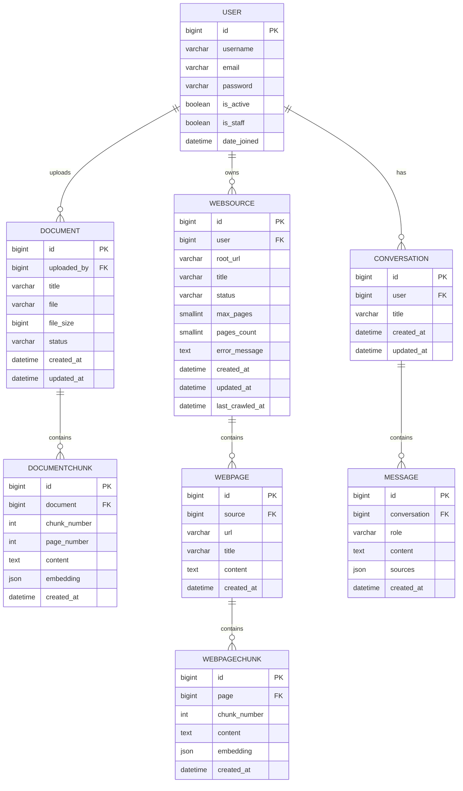

# 10 — MySQL Database Design

Sources: `backend/config/settings.py`, model files, and migration files under `conversations/migrations/` and `documents/migrations/`.

---

## 1. Database configuration

`settings.py` configures MySQL:

```python
DATABASES = {
    "default": {
        "ENGINE": "django.db.backends.mysql",
        "NAME": os.getenv("DB_DATABASE"),
        "USER": os.getenv("DB_USERNAME"),
        "PASSWORD": os.getenv("DB_PASSWORD"),
        "HOST": os.getenv("DB_HOST", "127.0.0.1"),
        "PORT": os.getenv("DB_PORT", "3306"),
        "OPTIONS": {"charset": "utf8mb4"},
    }
}
```

No credential values are reproduced here. README setup examples use different variable names (`DB_NAME`, `DB_USER`) than the code (`DB_DATABASE`, `DB_USERNAME`).

A zero-byte `backend/db.sqlite3` file exists but is not configured as the database.

---

## 2. ER diagram



---

## 3. User

No custom user model exists. `backend/accounts/models.py` is empty boilerplate. The app uses `django.contrib.auth.models.User` through `settings.AUTH_USER_MODEL`.

Relevant standard fields: `id`, `username`, `email`, password hash, `is_active`, `is_staff`, `is_superuser`, `date_joined`, `last_login`.

Relationships from this project:

- `user.documents` → Documents
- `user.web_sources` → WebSources
- `user.conversations` → Conversations

`RegisterSerializer` enforces case-insensitive username/email uniqueness before calling `create_user()`.

---

## 4. Document

Defined in `documents/models.py`.

| Field | Type | Notes |
|---|---|---|
| `id` | BigAutoField | Primary key |
| `uploaded_by` | FK to User | `CASCADE`, `related_name="documents"` |
| `title` | CharField(255) | From filename |
| `file` | FileField | `upload_to=document_upload_path` |
| `file_size` | PositiveBigIntegerField | Bytes |
| `status` | CharField(20) | `uploaded/processing/completed/failed` |
| `created_at` | DateTimeField(auto_now_add) | — |
| `updated_at` | DateTimeField(auto_now) | — |

Meta: `ordering = ["-created_at"]`.

---

## 5. DocumentChunk

| Field | Type | Notes |
|---|---|---|
| `id` | BigAutoField | Primary key |
| `document` | FK to Document | `CASCADE`, `related_name="chunks"` |
| `chunk_number` | PositiveIntegerField | Global chunk order |
| `page_number` | PositiveIntegerField | Citation page |
| `content` | TextField | Chunk text |
| `embedding` | JSONField(null=True, blank=True) | 384 floats |
| `created_at` | DateTimeField(auto_now_add) | — |

Constraints:

- `unique_document_chunk = UniqueConstraint(fields=["document", "chunk_number"])`
- `document_page_idx = Index(fields=["document", "page_number"])`

Meta ordering: `["chunk_number"]`.

---

## 6. WebSource

| Field | Type | Notes |
|---|---|---|
| `id` | BigAutoField | Primary key |
| `user` | FK to User | `CASCADE`, `related_name="web_sources"` |
| `root_url` | URLField(2048) | Start URL |
| `title` | CharField(500, blank) | First page title |
| `status` | CharField(20) | `queued/processing/completed/failed` |
| `max_pages` | PositiveSmallIntegerField(default=5) | Page limit |
| `pages_count` | PositiveSmallIntegerField(default=0) | Success count |
| `error_message` | TextField(blank) | Truncated to 2000 chars |
| `created_at`, `updated_at` | DateTimeField | — |
| `last_crawled_at` | DateTimeField(null=True) | Success timestamp |

Meta ordering: `["-created_at"]`.

---

## 7. WebPage

| Field | Type | Notes |
|---|---|---|
| `id` | BigAutoField | Primary key |
| `source` | FK to WebSource | `CASCADE`, `related_name="pages"` |
| `url` | URLField(2048) | Crawled page |
| `title` | CharField(500, blank) | Extracted title |
| `content` | TextField | Extracted text |
| `created_at` | DateTimeField(auto_now_add) | — |

Constraint:

- `unique_webpage_per_source = UniqueConstraint(fields=["source", "url"])`

Meta ordering: `["id"]`.

---

## 8. WebPageChunk

| Field | Type | Notes |
|---|---|---|
| `id` | BigAutoField | Primary key |
| `page` | FK to WebPage | `CASCADE`, `related_name="chunks"` |
| `chunk_number` | PositiveIntegerField | Per-page order |
| `content` | TextField | Chunk text |
| `embedding` | JSONField(null=True, blank=True) | 384 floats |
| `created_at` | DateTimeField(auto_now_add) | — |

Constraints/indexes:

- `unique_webpage_chunk = UniqueConstraint(fields=["page", "chunk_number"])`
- `webpage_chunk_idx = Index(fields=["page", "chunk_number"])`

Meta ordering: `["chunk_number"]`.

---

## 9. Conversation

| Field | Type | Notes |
|---|---|---|
| `id` | BigAutoField | Primary key |
| `user` | FK to User | `CASCADE`, `related_name="conversations"` |
| `title` | CharField(255, default="New Chat") | Chat title |
| `created_at` | DateTimeField(auto_now_add) | — |
| `updated_at` | DateTimeField(auto_now) | Drives ordering |

Meta ordering: `["-updated_at"]`.

Title behavior: `ConversationAskView` changes `"New Chat"` to the first 60 characters of the first question after two messages exist.

---

## 10. Message

| Field | Type | Notes |
|---|---|---|
| `id` | BigAutoField | Primary key |
| `conversation` | FK to Conversation | `CASCADE`, `related_name="messages"` |
| `role` | CharField(20) | `user` or `assistant` |
| `content` | TextField | Message text |
| `sources` | JSONField(default=list, blank=True) | Citation metadata |
| `created_at` | DateTimeField(auto_now_add) | — |

Meta ordering: `["created_at"]`.

No index is declared on `(conversation, created_at)`; model ordering plus the FK index may be enough initially, but this should be measured at scale.

---

## 11. One-to-many relationships

```text
User
 ├── Document
 │     └── DocumentChunk
 ├── WebSource
 │     └── WebPage
 │           └── WebPageChunk
 └── Conversation
       └── Message
```

All foreign keys use `on_delete=models.CASCADE`, so deleting a parent removes children.

---

## 12. Unique constraints

| Constraint | Purpose |
|---|---|
| `unique_document_chunk` | Prevent duplicate chunk numbers inside one document |
| `unique_webpage_per_source` | Prevent crawling the same URL twice under one source |
| `unique_webpage_chunk` | Prevent duplicate chunk numbers inside one page |
| `RegisterSerializer` checks | Case-insensitive unique username/email at API level |

There is no database-level unique constraint on `auth_user.username` beyond Django's own schema, and no custom unique constraint on document titles.

---

## 13. Indexes

Explicit indexes:

- `document_page_idx` on `(document, page_number)`;
- `webpage_chunk_idx` on `(page, chunk_number)`.

Django automatically creates indexes for primary keys and foreign keys.

Potential missing indexes for production:

- `(uploaded_by, created_at)` on Document;
- `(user, created_at)` on WebSource;
- `(user, updated_at)` on Conversation;
- `(conversation, created_at)` on Message;
- an index on status fields if filtered heavily.

No query plans were run while preparing this guide, so these are recommendations, not measured findings.

---

## 14. JSON fields

Three JSON fields:

- `DocumentChunk.embedding`
- `WebPageChunk.embedding`
- `Message.sources`

Embedding JSON:

```python
embedding=embedding.tolist()
```

MySQL stores the 384-number list as JSON text. It is read back into Python by Django and converted to `float32` NumPy arrays for FAISS.

Sources JSON:

```python
Message.objects.create(..., sources=sources)
```

This stores the same citation array returned by the API.

Trade-off: JSON is convenient but not indexable for vector similarity inside MySQL in this implementation.

---

## 15. Query optimization in the code

Verified uses:

- `select_related("document")` for PDF chunks;
- `select_related("page", "page__source")` for web chunks;
- `prefetch_related("pages")` for web-source listing;
- `embedding__isnull=False` to skip unindexed rows;
- user filters applied in SQL before loading embeddings.

Not implemented:

- pagination;
- `.only()` / `.defer()` to avoid full chunk content when only embeddings are needed;
- ANN/vector index in the database;
- connection pooling;
- read replicas.

---

## 16. User-level data isolation

Every query that returns user-owned data includes the owner:

```python
Document.objects.filter(uploaded_by=self.request.user)
WebSource.objects.filter(user=request.user)
Conversation.objects.filter(user=request.user)
DocumentChunk.objects.filter(document__uploaded_by=user, ...)
WebPageChunk.objects.filter(page__source__user=user, ...)
```

Detail views use `get_object_or_404(..., user=request.user)`.

This means a user cannot see another user's document, web source, conversation, or chunks through implemented API paths.

---

## 17. Why a relational database is still useful in RAG

A vector index alone is not enough. MySQL provides:

- user identity and authentication links;
- ownership and authorization filters;
- source metadata;
- original chunk text for prompts and citations;
- processing status;
- conversation history;
- transactional chunk replacement;
- cascade deletes;
- joins such as chunk → document → owner.

A good interview answer:

> “The vector index answers ‘what is similar?’ MySQL answers ‘what is allowed, what is the source, what is the original text, and what happened in the conversation?’ Both are needed.”

---

## 18. Interview Q&A

### Q1. Why store embeddings in JSON instead of a binary column?

**Spoken:** “It was the simplest local implementation: NumPy vector to Python list to JSONField.”

**Detail:** No custom binary field or vector DB extension is used.

**Source:** `models.py`, ingestion services.

**Follow-up:** Production alternative? Dedicated vector DB or binary BLOB with a persistent index.

---

### Q2. How are duplicate chunks prevented?

**Spoken:** “Unique constraints on `(document, chunk_number)` and `(page, chunk_number)`.”

**Detail:** The processing services also delete old chunks before bulk-creating replacements.

**Source:** `models.py`, `document_processor.py`, `web_embedding_service.py`.

**Follow-up:** What about duplicate content with different chunk numbers? Not prevented.

---

### Q3. Why `select_related` in vector search?

**Spoken:** “To fetch document/page/source metadata in the same SQL query rather than one query per chunk.”

**Detail:** Important because search iterates over many chunks.

**Source:** `vector_search.py`.

**Follow-up:** Is it enough at millions of rows? No; pagination/batching and vector storage design needed.

---

### Q4. What happens when a user is deleted?

**Spoken:** “CASCADE removes their documents, web sources, conversations, and all child rows.”

**Detail:** All FKs use `CASCADE`.

**Source:** model files.

**Follow-up:** Is there soft delete? No.

---

### Q5. How is conversation history stored?

**Spoken:** “One Conversation row and two Message rows per successful ask: user and assistant. The assistant row stores sources JSON.”

**Detail:** Both messages are written in `transaction.atomic()`.

**Source:** `conversations/models.py`, `conversations/views.py`.

**Follow-up:** Is history used in retrieval? No.
