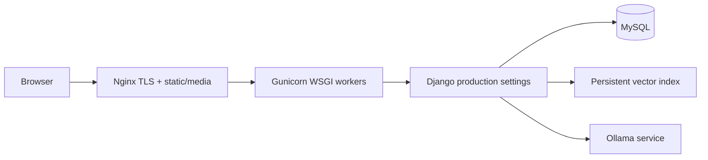

# 12 — Production Deployment (PROPOSED)

> **Status warning:** None of the deployment steps in this file are implemented in the repository. No Dockerfile, Gunicorn config, Nginx config, systemd unit, SSL config, CI/CD pipeline, Celery setup, Redis setup, or persistent vector index was found. Everything below is a **PROPOSED improvement**.

---

## 1. Current state

The current application is a local development project:

- Django runserver is documented in `README.md`.
- Vite dev server runs on port 5173.
- MySQL is configured by environment variables.
- Ollama is expected at `127.0.0.1:11434`.
- `DEBUG = True`.
- JWTs are in browser `localStorage`.
- Processing and crawling are synchronous.
- FAISS index is rebuilt per search.

Do not say it is deployed in production.

---

## 2. Proposed request flow

```text
Browser
  -> HTTPS
  -> Nginx
  -> Gunicorn (WSGI workers)
  -> Django REST Framework
  -> MySQL / persistent vector index / Ollama service
  -> JSON response
  -> Nginx
  -> Browser
```



---

## 3. Linux server setup — PROPOSED

1. Provision a Linux VM (Ubuntu LTS is a common choice).
2. Create a non-root deploy user.
3. Install system packages: Python, MySQL client libraries, Nginx, Git, certbot.
4. Configure firewall: allow SSH (restricted), HTTP 80, HTTPS 443; deny direct access to 8000, 3306, 11434, Redis/Celery ports.
5. Set timezone, NTP, and basic hardening.
6. Keep secrets in environment files with restricted permissions or a secret manager.

---

## 4. Python virtual environment — PROPOSED

```bash
cd /srv/knowhub/backend
python3 -m venv .venv
source .venv/bin/activate
pip install --upgrade pip
pip install -r requirements.txt
```

Blocker: `requirements.txt` is **NOT PRESENT** in the repository. It must be generated from the actual environment first:

```bash
pip freeze > requirements.txt
```

This command was not run while preparing this guide.

---

## 5. Django production settings — PROPOSED

Create `config/settings_prod.py` or use environment-driven settings:

- `DEBUG = False`;
- `ALLOWED_HOSTS` set to real domains;
- `SECRET_KEY` loaded from secret store;
- secure cookie flags if switching to cookies;
- `SECURE_SSL_REDIRECT = True`;
- HSTS settings;
- `CSRF_TRUSTED_ORIGINS` for real domains;
- CORS origins restricted to production frontend;
- static files configured with `STATIC_ROOT`;
- production logging;
- database connection settings and TLS;
- upload size limits retained;
- strict media access policy.

Current hardcoded development secret and debug mode must not be deployed.

---

## 6. MySQL configuration — PROPOSED

- dedicated database/user with least privilege;
- strong password from secret manager;
- `utf8mb4`;
- TLS between app and DB where possible;
- backups with `mysqldump` or managed snapshots;
- point-in-time recovery if available;
- monitoring of connections, slow queries, disk, replication lag;
- indexes reviewed with real query plans;
- connection pooling if concurrency requires it.

No migration was run while preparing this guide.

---

## 7. Gunicorn — PROPOSED

```bash
gunicorn config.wsgi:application \
  --bind 127.0.0.1:8000 \
  --workers 3 \
  --threads 2 \
  --timeout 300 \
  --access-logfile /var/log/knowhub/gunicorn-access.log \
  --error-logfile /var/log/knowhub/gunicorn-error.log
```

Notes:

- `config.wsgi.application` is verified in `config/wsgi.py`.
- Worker count must be sized from CPU/RAM and profiling, not guessed.
- A 180-second Ollama timeout means HTTP workers can be occupied for a long time.
- Long PDF/crawl processing should be moved out of request workers.

No Gunicorn config file exists currently.

---

## 8. Nginx — PROPOSED

Responsibilities:

- TLS termination;
- reverse proxy to Gunicorn;
- serve static files;
- serve or protect media files;
- client body size limit aligned with 20 MB upload;
- proxy read timeout aligned with LLM latency;
- basic rate limiting;
- access logs.

Example config sketch:

```nginx
server {
    listen 443 ssl http2;
    server_name knowhub.example.com;

    client_max_body_size 21M;

    location /static/ {
        alias /srv/knowhub/backend/staticfiles/;
    }

    location / {
        proxy_pass http://127.0.0.1:8000;
        proxy_set_header Host $host;
        proxy_set_header X-Forwarded-For $proxy_add_x_forwarded_for;
        proxy_set_header X-Forwarded-Proto $scheme;
        proxy_read_timeout 300s;
    }
}
```

This is illustrative only and is not present in the repository.

---

## 9. Static and media files — PROPOSED

Static:

```bash
python manage.py collectstatic
```

`STATIC_ROOT` is not configured in current settings, so this must be added.

Media:

- current uploads go to `backend/media/documents/...`;
- production should use object storage (S3-compatible) or a mounted volume with strict permissions;
- never expose arbitrary media without authorization checks;
- downloads should go through a Django endpoint that checks ownership if files need to be served.

No media URL route exists now.

---

## 10. HTTPS and SSL — PROPOSED

- Use Let's Encrypt/certbot or enterprise CA certificates.
- Redirect HTTP to HTTPS.
- Enable HSTS after verifying subdomains.
- Terminate TLS at Nginx or a load balancer.
- Do not expose Django directly to the internet.
- Keep Ollama bound to localhost/private network with authentication if remote.

---

## 11. Environment variables — PROPOSED

Use a secret manager or protected `.env` with:

- Django secret key;
- debug flag;
- allowed hosts;
- DB credentials;
- CORS origins;
- Ollama URL/model;
- optional vector index path;
- logging level.

Never commit secrets. No values are reproduced in this guide.

---

## 12. Database migrations — PROPOSED

```bash
python manage.py makemigrations --check --dry-run
python manage.py migrate
python manage.py check --deploy
```

Verified migration files exist for documents and conversations. No migrations were applied during documentation preparation.

---

## 13. Logging — PROPOSED

Current code catches many exceptions without logging them. Add:

- structured JSON logs;
- request IDs;
- Gunicorn access/error logs;
- Nginx logs;
- application `logger.exception()` in service failures;
- LLM latency and model errors;
- crawl URL/error summaries;
- embedding batch timing;
- no secrets or full prompt bodies in logs by default.

---

## 14. Monitoring — PROPOSED

Track:

- HTTP 4xx/5xx rate;
- p50/p95/p99 latency per endpoint;
- LLM request latency and timeout rate;
- FAISS search latency and vector count;
- MySQL slow queries and connection usage;
- Celery queue depth and failures;
- disk usage for media/indexes;
- Ollama model availability;
- crawler failure rate by host.

No monitoring stack is implemented.

---

## 15. Backups — PROPOSED

- nightly MySQL dumps;
- media/object-storage versioning;
- vector index snapshots or reproducible rebuild procedure;
- encrypted backups;
- restore drills;
- documented RPO/RTO.

Because FAISS is currently rebuilt from MySQL, losing the index is not fatal, but re-embedding may be expensive.

---

## 16. systemd — PROPOSED

Unit sketch for Gunicorn:

```ini
[Unit]
Description=KnowHub AI Django
After=network.target mysql.service

[Service]
User=deploy
Group=deploy
WorkingDirectory=/srv/knowhub/backend
EnvironmentFile=/srv/knowhub/backend/.env
ExecStart=/srv/knowhub/backend/.venv/bin/gunicorn config.wsgi:application --bind 127.0.0.1:8000 --workers 3
Restart=always

[Install]
WantedBy=multi-user.target
```

A separate unit would be needed for Celery worker and beat. No systemd files exist currently.

---

## 17. Firewall and network security — PROPOSED

- UFW/firewalld: allow 80/443/SSH only.
- MySQL bound to private interface.
- Ollama not publicly exposed.
- Redis not publicly exposed.
- Outbound firewall rules for crawler destinations.
- Deny cloud metadata IP ranges.
- SSH key auth only, ideally VPN/bastion.
- Fail2ban or similar for repeated failed logins.

---

## 18. PHP-FPM vs Gunicorn for a Laravel developer

| Laravel/PHP-FPM | Django/Gunicorn |
|---|---|
| PHP-FPM manages worker processes | Gunicorn manages WSGI worker processes |
| Nginx passes PHP via FastCGI | Nginx proxies HTTP to Gunicorn |
| Request lifecycle boots framework per request | WSGI app loaded in worker; framework state persists |
| Long jobs go to Laravel queues/Horizon | Long jobs go to Celery/RQ |
| `php-fpm.conf` pool tuning | `--workers`, `--threads`, worker class tuning |
| Opcache keeps bytecode | Python imports/modules stay in worker memory |
| Supervisor often manages queues | systemd manages Gunicorn/Celery |

Laravel analogy:

> “Gunicorn is roughly the Python equivalent of the process manager that sits between Nginx and the framework, similar to how PHP-FPM sits between Nginx and Laravel. The big difference is that the Django app stays loaded in the worker process.”

---

## 19. How Gunicorn workers handle concurrency

- Each worker is a separate OS process.
- With default sync workers, one worker generally handles one request at a time.
- Multiple workers provide parallelism across CPU cores.
- Threads or async workers can handle more I/O-bound concurrency but require memory and compatibility care.
- Module-level singletons such as the embedding model may exist once per worker process.

Important for this project:

- loading Sentence Transformers per worker consumes memory;
- an LLM request can hold a worker for up to 180 seconds;
- therefore long AI work should be queued.

No worker concurrency was measured.

---

## 20. Why PDF processing and crawling should become background jobs — PROPOSED

Current behavior:

- upload request waits for extraction, chunking, embeddings, and DB writes;
- crawl request waits for robots, page fetches, parsing, chunking, and embeddings;
- Ollama ask waits up to 180 seconds.

Problems:

- HTTP timeouts;
- exhausted Gunicorn workers;
- poor UX;
- no retry;
- no progress tracking beyond status fields;
- no job id.

Move to Celery:

```text
API creates Document/WebSource + queued status
  -> enqueue job
  -> return 202 Accepted with job/source id
  -> Celery worker processes
  -> frontend polls status or receives WebSocket event
```

---

## 21. Celery and Redis integration — PROPOSED

Concepts:

- **Celery** — distributed task queue; runs background Python jobs.
- **Redis** — broker and result backend in a simple setup.
- **worker** — process that executes tasks.
- **beat** — scheduler for periodic tasks.

Proposed tasks:

```text
process_document_task(document_id)
crawl_website_task(source_id)
rebuild_vector_index_task(user_id)
delete_document_artifacts_task(document_id)
```

Implementation changes needed:

- add Celery config and app instance;
- return 202 from upload/crawl endpoints;
- use status fields properly (`queued`, `processing`, `completed`, `failed`);
- add retry policies and idempotency;
- add per-user/per-IP rate limits;
- add monitoring (Flower or metrics).

None of this is implemented.

---

## 22. Deploying Ollama and Qwen separately — PROPOSED

Current code hardcodes:

```python
OLLAMA_URL = "http://127.0.0.1:11434/api/generate"
```

To deploy separately:

- move URL to environment variable;
- run Ollama on a private model host or GPU node;
- require authentication/network policy between Django and Ollama;
- pre-pull and version the model;
- expose health checks;
- set concurrency limits;
- monitor memory/GPU;
- consider larger approved models for quality;
- add fallback provider.

Do not expose Ollama publicly.

---

## 23. Production vector indexing — PROPOSED

Options:

1. **Persistent FAISS index** — write index files with stable vector IDs, load once per worker, handle incremental updates.
2. **Dedicated vector database** — e.g. Qdrant/Milvus/Weaviate/pgvector; app handles IDs and metadata filtering.
3. **Hybrid approach** — MySQL source of truth + vector DB index rebuilt from events.

Requirements:

- stable mapping from vector ID to `DocumentChunk`/`WebPageChunk`;
- model version tracking;
- incremental add/update/delete;
- snapshot and restore;
- user filtering;
- ANN index for scale;
- reindex procedure;
- evaluation of recall.

Current code has none of these.

---

## 24. Deployment checklist summary

| Step | Status |
|---|---|
| Linux server | PROPOSED |
| Virtual environment | PROPOSED |
| `requirements.txt` | MISSING / NEEDS CREATION |
| Production Django settings | NOT IMPLEMENTED |
| MySQL hardening | PROPOSED |
| Gunicorn | NOT IMPLEMENTED |
| Nginx | NOT IMPLEMENTED |
| Static files | NOT IMPLEMENTED |
| Media strategy | PROPOSED |
| HTTPS/SSL | NOT IMPLEMENTED |
| Secret management | NOT IMPLEMENTED |
| Migrations | Files exist; not run here |
| Logging/monitoring | NOT IMPLEMENTED |
| Backups | NOT IMPLEMENTED |
| systemd | NOT IMPLEMENTED |
| Firewall | NOT IMPLEMENTED |
| Celery/Redis | NOT IMPLEMENTED |
| Persistent vector index | NOT IMPLEMENTED |
| Separated Ollama service | NOT IMPLEMENTED |

---

## 25. Interview Q&A

### Q1. How would you deploy this?

**Spoken:** “Nginx terminates TLS and serves static files, Gunicorn runs the Django WSGI app, MySQL stores data, Celery handles long jobs, Redis is the broker, and Ollama runs as a separate private model service. The vector index would be persistent or in a vector DB.”

**Follow-up:** Why separate Ollama? To scale and monitor model inference independently.

---

### Q2. Gunicorn vs PHP-FPM?

**Spoken:** “Both manage backend worker processes behind Nginx. With PHP-FPM, Laravel is booted per request; with Gunicorn, Django stays loaded in the worker. Both need tuning and both hand long jobs to a queue.”

**Follow-up:** Why multiple workers? Parallelism and isolation.

---

### Q3. Why not use runserver?

**Spoken:** “It is a development server, not built for production concurrency, security, or reliability.”

**Follow-up:** What replaces it? Gunicorn behind Nginx.

---

### Q4. Why move crawling to Celery?

**Spoken:** “Crawling can take many seconds and would block an HTTP worker.”

**Follow-up:** What does the API return? 202 with a job/source ID.

---

### Q5. How would you make FAISS production-safe?

**Spoken:** “Persist the index, keep stable vector IDs, load once per worker, add incremental updates, and consider ANN or a vector database at scale.”

**Follow-up:** What remains source of truth? MySQL.
